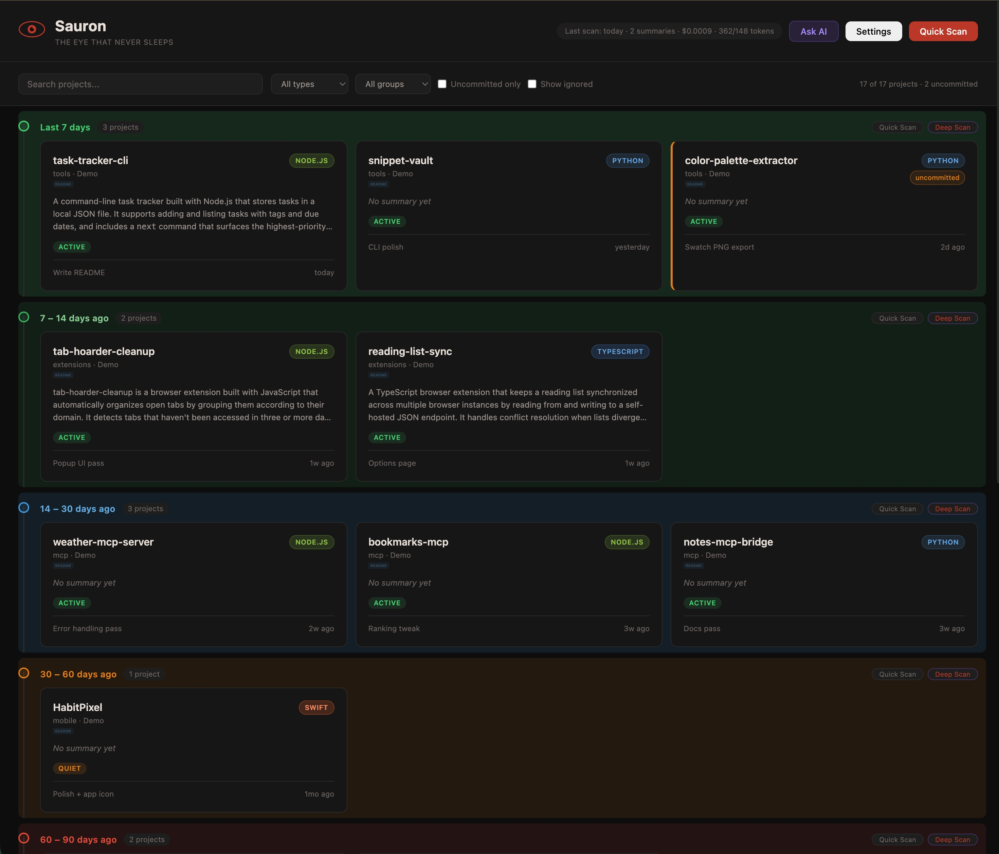
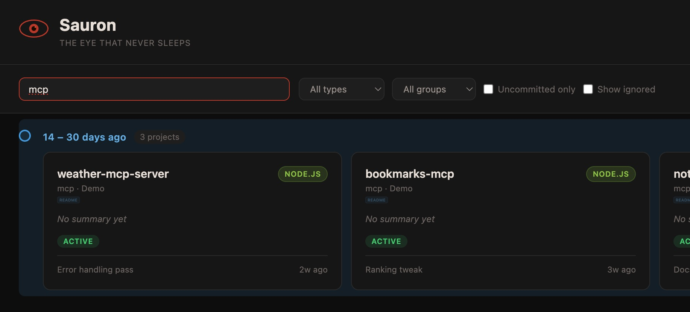
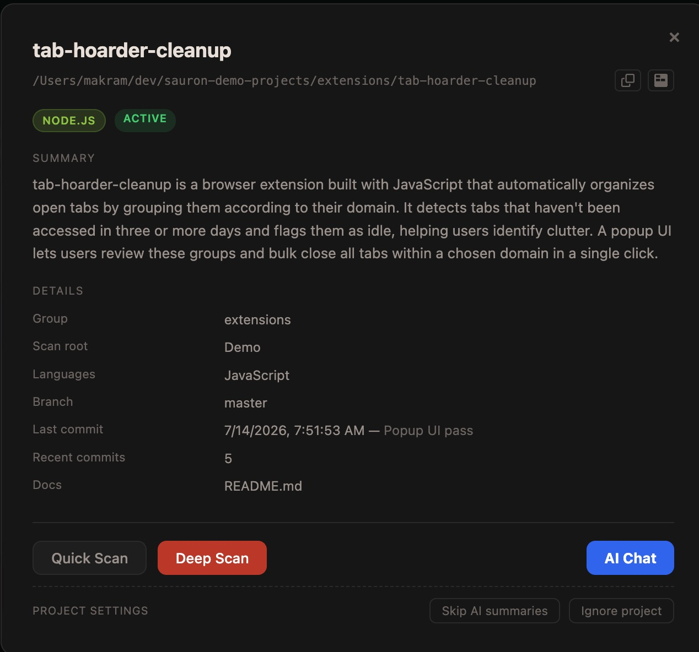
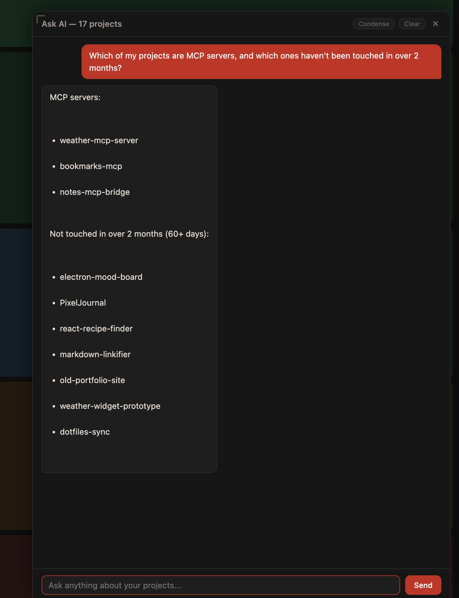
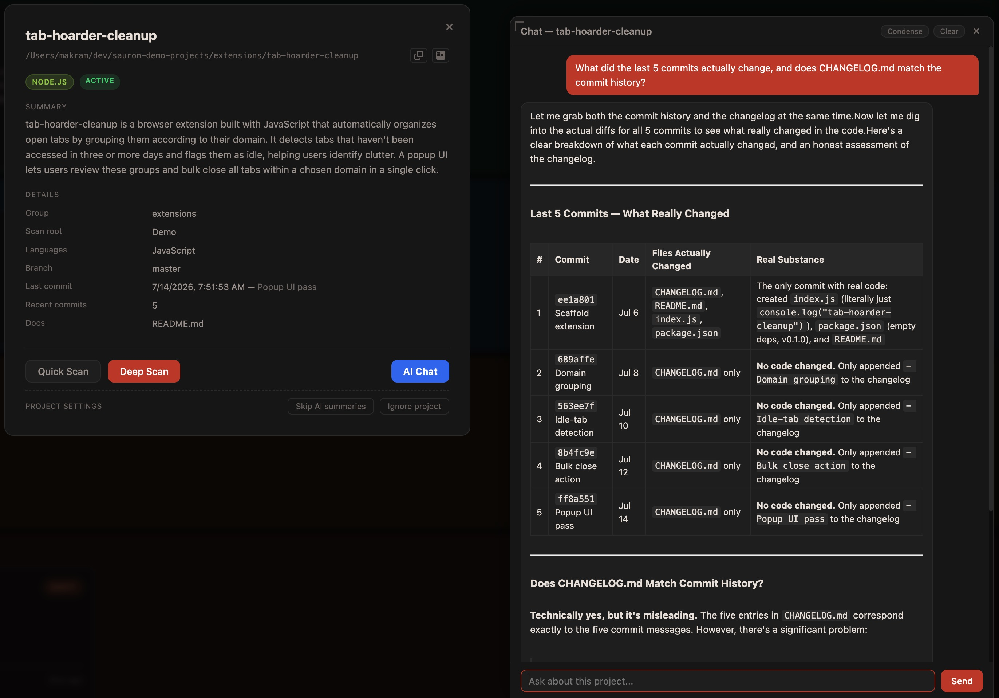

# Sauron

**The Eye that watches all your projects.**

Sauron is a local dashboard that scans your development directories, tracks every project's git activity, flags uncommitted changes, detects tech stacks and integrations, and generates AI-powered summaries. It groups projects by how recently they were touched so you can see at a glance what needs your attention.

https://github.com/user-attachments/assets/13e725c0-e3db-44cc-b73b-fa044fd4c79e



Projects are organized into temporal buckets (last 7 days, 14 days, 30 days, etc.) with color-coded sections. Each card shows the project type, uncommitted status, detected integrations, AI summary, and last commit info.



Search and filter by name, type, group, or uncommitted status to narrow the fleet down to exactly what you're looking for.



Click any project to see full details including git metadata, detected integrations, documentation status, and an AI-generated summary. From here you can trigger a rescan or open an AI chat session scoped to that project.



The global **Ask AI** chat answers questions across your whole fleet at once — e.g. which projects use a given integration, or haven't been touched in a while — from project metadata only.



The per-project AI chat can browse files, search code, run read-only git commands, and answer questions about that specific project. It uses Claude's tool-use to explore the codebase on demand.

---

## Quick Start

```bash
git clone https://github.com/DrBenedictPorkins/Sauron.git
cd Sauron
npm install
cp .env.example .env
```

Edit `.env` with your settings:

```
ANTHROPIC_API_KEY=sk-ant-...
SCAN_ROOTS=~/projects:Projects,~/dev:Dev
CLAUDE_MODEL=claude-haiku-4-5
```

Run it:

```bash
npm start
```

Open `http://127.0.0.1:7777` (or whatever `HOST:PORT` you set). Click **Quick Scan** to discover projects and gather metadata — free, no AI calls. To generate AI summaries, expand a project's time-bucket group or open an individual project and click **Deep Scan** — you'll see a real cost estimate before anything runs.

---

## How It Works

### Scanning

Sauron recursively walks the directories listed in `SCAN_ROOTS`. A directory is identified as a project if it contains `.git`, `package.json`, `pyproject.toml`, or `*.xcodeproj`. Directories without these markers are treated as grouping folders (e.g. `~/dev/firefox-extensions/` contains projects, but isn't one itself).

Two scan modes:

- **Quick Scan** -- Full directory crawl, collects git metadata (last commit, branch, uncommitted changes, 30-day commit count), detects project type, languages, integrations, and checks for outdated dependencies. No AI calls. Free, and always available for the whole fleet or a scoped selection.
- **Deep Scan** -- Everything Quick Scan does, plus sends project context (README, CLAUDE.md, recent git log) to Claude for a 2-3 sentence summary. Summaries are cached by commit hash and only regenerated when a project actually changes.

Deep Scan always requires an explicit selection — there's no single button that summarizes everything. Trigger it per temporal bucket (review a checklist of that group's projects, deselect any you don't want, see a real cost estimate, then confirm) or per individual project (a lighter one-click confirm that always regenerates that project's summary). A project can also be marked to skip AI summaries entirely via **Skip AI summaries** in its detail view — it still gets Quick Scan metadata, just never an AI call.

Activity status (Active / Stale / Abandoned) is computed deterministically from git history, not by the AI. If a project's commit changes after its summary was generated, its card shows an **Outdated** badge until it's re-summarized.

### Project Detection

| Signal | Detected As |
|--------|------------|
| `package.json` with `electron` dep | Electron |
| `package.json` with `react-native` dep | React Native |
| `package.json` with `next` dep | Next.js |
| `package.json` with `react` dep | React |
| `package.json` + `tsconfig.json` | TypeScript |
| `package.json` (plain) | Node.js |
| `pyproject.toml` or `setup.py` | Python |
| `*.xcodeproj` | Swift |
| `.git` only (no config files) | Scans file extensions to detect language |

### Integration Detection

Sauron checks `package.json` dependencies and `pyproject.toml` contents for known libraries: Slack, Discord, MCP, Electron, OpenAI, Anthropic, LangChain, AWS, Supabase, Stripe, Pulumi. It also detects Docker via `Dockerfile` or `docker-compose.yml`.

### AI Chat

There are two chat modes. The **global chat** ("Ask AI" in the header) answers project-discovery questions across your whole fleet at once — e.g. "which projects use Stripe" — from project metadata only, with no file access. Each **individual project** also gets its own scoped chat session with real tool access:

- **list_directory** -- Browse the file tree
- **read_file** -- Read file contents (with offset/limit for large files)
- **get_file_info** -- File metadata (size, modified date, line count)
- **search_files** -- Grep for patterns across the project
- **git_command** -- Run read-only git commands (log, diff, blame, branch, etc.)

No write operations are allowed. File access is sandboxed to the project directory.

Chat sessions persist per project. **Condense** compresses the conversation history using AI (aggressive compression for old turns, light compression for recent ones) to save context. **Clear** wipes the session entirely.

### Configuration

All configuration lives in `.env`. Copy `.env.example` to get started.

| Variable | Description | Default |
|----------|-------------|---------|
| `ANTHROPIC_API_KEY` | Claude API key (required) | -- |
| `SCAN_ROOTS` | Comma-separated `path:label` pairs | -- |
| `CLAUDE_MODEL` | Model alias for all AI calls | `claude-haiku-4-5` |
| `HOST` | Server bind address | `127.0.0.1` |
| `PORT` | Server port | `7777` |
| `ACTIVE_CUTOFF_DAYS` | How far back to look for "active" projects | `30` |
| `MAX_SUMMARIES_PER_SCAN` | Max projects in a single Deep Scan selection | `50` |
| `IGNORE_PATHS` | Comma-separated directory paths to skip | -- |
| `PRICE_INPUT_MTOK` / `PRICE_OUTPUT_MTOK` | Per-million-token pricing for `CLAUDE_MODEL`, used to compute the in-app cost meter | `0.80` / `4.00` (Haiku) |

### Cost

All AI calls use the model specified in `CLAUDE_MODEL` (defaults to Haiku). Costs are tracked per scan and displayed in the UI header, and every Deep Scan confirmation shows a real estimate — computed from your actual scan history — before it runs.

Typical costs:
- Quick Scan: **$0.00** (no AI calls, any scope)
- Deep Scan: **~$0.0005-0.001 per summary** — flat per project, since the prompt is bounded (README/CLAUDE.md excerpts + recent commits, not full repo contents) rather than proportional to repo size. A single Deep Scan selection is capped at `MAX_SUMMARIES_PER_SCAN` (default 50).
- Chat message: **~$0.001-0.005** per turn

### Tech Stack

- **Backend**: Node.js, Express, better-sqlite3
- **Frontend**: Vanilla HTML/CSS/JS (no framework)
- **AI**: Anthropic Claude API (streaming, tool use)

### Data

All data stays local. `sauron.db` (SQLite) stores project metadata and scan history. The `.env` file holds your API key and scan paths. Neither is committed to git.

## License

MIT
